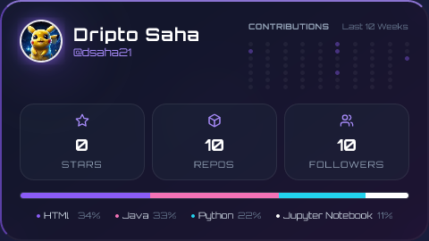
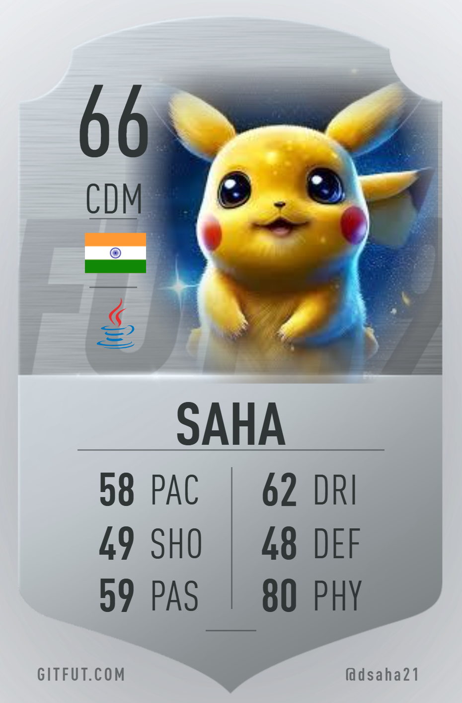

<h1 align='center'>Hi there 👋, I AM DRIPTO !!</h1>
<h3 align='center'>A Software Engineer </h3>
<h4 align='center'><a href="https://dsaha21.github.io/" target="_blank">MY PORTFOLIO</a></h4>
<!-- 
Check out <a href="https://www.freecodecamp.org/" target="_blank">freeCodeCamp</a>.
 -->

    <!--  -->

    

 

  

  

---

## About Me:

A BTech engineer in Electronics and Computer Science Engineering from KIIT University, keen to explore the world of technologies

- 🔭 I’m currently working on small POCs using C and Go 
- 🌱 I’m currently learning ML inference techniques and compilers, Go and LLDs.
- 📫 How to reach me: Linkedin / Github 
- ⚡ Fun fact: I Keep interest in Quantum Computing, Astronomy, Open World Video Games. Also a human being gets an avg of 4200-4500 weeks during their lifetime. Make everyday count 

## 💻 Tech Stack

- 🔥 Core Languages : Python, Java, C++, Javascript.
- 🌐 Web DevFrontend : HTML, CSS, React, Streamlit, Reflex
- ⚙️ Backend & Frameworks : Flask, FastApi, Springboot, Reflex
- 🗄️ Database & Tools : MySQL, Git, VSCode, Zed, Linux
- Hands on Knowledge : Rashberry Pi 3 and 4, Arduino Uno, Cisco Packet Tracer, Blender, Omarchy, Linux Mint  

 © 2026 [Dripto Saha]

<!--
For Theme and Stat Cards
Required to deploy -> Cron job -> https://github-stats-extended.vercel.app/frontend/docs/deploy/

**dsaha21/dsaha21** is a ✨ _special_ ✨ repository because its `README.md` (this file) appears on your GitHub profile.
https://github.com/dsaha21/dsaha21/blob/main/GlaringTanCanary.webp
Here are some ideas to get you started:

- 🔭 I’m currently working on ...
- 🌱 I’m currently learning ...
- 👯 I’m looking to collaborate on ...
- 🤔 I’m looking for help with ...
- 💬 Ask me about ...
- 📫 How to reach me: ...
- 😄 Pronouns: ...
- ⚡ Fun fact: ...
-->
